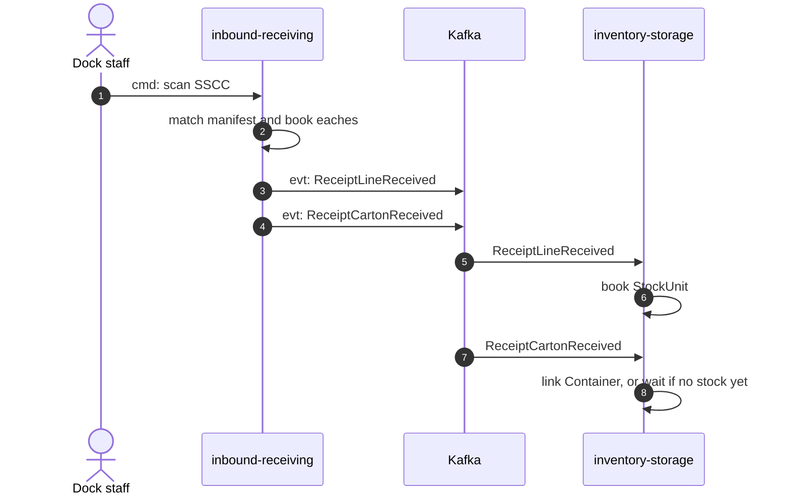

# ADR 0012: Hierarchical ASN with SSCC cartons and carton-aware receiving

## Status

Proposed (2026-10-23). Phase 0 of the mastercase / GTIN adoption plan: this ADR
pins the design, nothing is built and no Go code, migration or API
specification changes with it. The names below are the ones pinned in
`.hermes/plans/mastercase-briefs/contracts.md` (sections 0 and 2) of the
warehouse-systems workspace; the plan is
`.hermes/plans/2026-10-23_225746-mastercase-gtin-handling.md`. Sibling
Phase 0 decisions: product-master (packaging hierarchy with GS1 GTIN) and
inventory-storage (Container / LPN and `BreakCase`). Additive to
[ADR 0002](./0002-aggregates-and-invariants.md) and
[ADR 0004](./0004-cloudevents-envelope-and-type-catalogue.md): no existing
field, event or route changes meaning.

## Context

Sellers will ship master cartons: outer cartons that hold N identical sellable
units, sometimes on a pallet, sometimes mixed. This service only knows "SKU and
a quantity in units". Verified on `origin/develop` (2026-10-23):

- **The ASN is flat.** `Asn{number, supplierRef, expectedArrival, lines[]}`
  with `Line{lineNo, sku, expectedQty}`. Line numbers are exactly 1..n, and
  `ErrDuplicateSKU` rejects two lines with the same SKU, so a line is
  one SKU rolled up. There is no GTIN, no carton, no pallet, no SSCC, no
  owner and no site on the ASN or the receipt.
- **The Receipt counts lines, not things.** `Open` copies the ASN lines into
  the receipt; each line holds `receivedGood` and `receivedDamaged`.
  `ReceiveLine(lineNo, qty, condition)` only ever adds (there is no negative
  receipt) and raises `ReceiptLineReceived`. `Close` computes the line
  discrepancies from those totals.
- **`ReceiptLineReceived` drives stock.** Its payload is
  `receipt_id, asn_number, line_no, sku, quantity, condition, received_at`
  ([ADR 0004](./0004-cloudevents-envelope-and-type-catalogue.md)).
  inventory-storage books `condition=Good` quantities only
  ([ADR 0003](./0003-local-copies-and-handover.md)). Quantity is in eaches
  because the SKU is the sellable unit.
- **`ReceiptClosed.discrepancies`** is `{line_no, sku, kind, expected_qty,
  received_qty, damaged_qty}` with `kind` in `Short`, `Over`, `Damaged`.
- REST today: `POST /asns`, `POST /receipts`, `POST /receipts/{id}/lines`
  (`lineNo`, `quantity`, `condition`), `POST /receipts/{id}/close`,
  `GET /receipts/{receiptId}`. REST bodies are camelCase; the event payloads
  of ADR 0004 are snake_case.

A mastercase breaks three assumptions at once. A carton has an identity (the
GS1 SSCC, AI 00) that the label carries and the ASN must match, otherwise the
carton is invisible to automated receiving ([5][8]). The ASN of the industry is
a tree (shipment, pallet, carton, item), not a list of SKUs ([9][10]). And the
receiver scans a case GTIN or an SSCC, not "+1" per unit ([6]). The
risk to design around is the cases-versus-eaches mix-up, so the ledger unit
stays the each ([18]).

## Decision

1. **The carton tree is optional and additive.** `Asn` gains `ownerRef` and
   `cartons[]`, both optional. A flat ASN keeps working exactly as today: same
   routes, same events, same invariants.
2. **Lines remain the per-SKU roll-up, in eaches.** `ErrDuplicateSKU` stays.
   Every existing consumer, the receipt's line counters and `ReceiptClosed`
   keep reading lines. Cartons describe the physical identity and manifest
   *behind* the lines, never instead of them. When cartons are present, they
   must cover every line.
3. **Carton shape (SOTPI-shaped: pallet, carton, items).**
   `Carton{sscc, parentSscc?, kind, contents[], grossWeightG?, dims?}`:
   - `kind` is `HOMOGENEOUS_CASE` or `MIXED`.
   - `contents[]` is `{lineNo, sku, gtin, qty, lot?, expiry?}`; `qty` is in
     eaches (contracts G1). `gtin` is a 14-digit zero-padded string, check
     digit validated by this service's own value object, never trusted from
     the client (G2). Accepted input lengths are 8, 12, 13 and 14.
   - `parentSscc` is the pallet SSCC. A pallet is only an SSCC referenced by
     its cartons, not a `Carton` entry, so the tree is two levels deep
     (pallet reference, carton, items). A pallet SSCC cannot also be a
     carton SSCC. Scanning a pallet SSCC is **not** a v1 receiving mode
     (PALLET flows are not implemented, G6).
   - `lot` (AI 10, max 20) and `expiry` (AI 17, a date) are captured on the
     carton contents and carried on the events from day one (G5). Enforcing
     FEFO is out of scope.
4. **Register-time invariants** (new errors, all `422`):
   - `ErrInvalidSscc`: not 18 digits or the mod-10 check digit fails (G3).
   - `ErrDuplicateSscc`: the SSCC repeats within the ASN, or already exists
     on the site.
   - `ErrHomogeneousCartonMixed`: a `HOMOGENEOUS_CASE` carton lists more than
     one SKU.
   - `ErrCartonContentsMismatch`: when cartons are present, the sum of carton
     contents per `lineNo` must equal that line's `expectedQty`.
   - A content's `sku` must equal the SKU of its `lineNo`, and the SKU copy
     check ([ADR 0003](./0003-local-copies-and-handover.md)) applies as today.

   `ErrCasePackMismatch` (a `HOMOGENEOUS_CASE` whose `qty` is not the
   `unitsPerPack` of the SKU's active CASE level) is checked **at receipt**,
   against the local `PackagingView` fed from product-master, not at register:
   the pack data may arrive after the ASN, and a mismatch at register would
   reject a document the seller already sent, while at receipt it is a
   finding about a physical carton.
5. **`ownerRef` is opaque.** Optional, max 64 characters of `[A-Za-z0-9._-]`
   (G4). It is validated by shape only, set at register, immutable, copied to
   the receipt and to the events, and never interpreted here: the fleet has no
   seller concept. Absent or empty means fleet-owned stock, which is all
   current data. Stock, listings and reservations are segregated by it
   downstream; commingling is a later per-item opt-in and is not designed here.
6. **Receiving modes.** `ReceiveByScan` resolves a scan to `(kind, id, qty)`
   (the floor client parses GS1 and the service re-validates, see contracts
   section 6). The receipt screen's expected kind must match the resolved kind:
   an each EAN printed on a case is rejected when a carton or case is expected.

   | mode | scan | books (via `ReceiveLine` rules) | carton identity |
   | --- | --- | --- | --- |
   | scan SSCC | `SSCC` | the manifest contents of that carton, per `lineNo`, as `Good` | `ReceiptCartonReceived`, `sealed=true`, `lpn` = the SSCC |
   | case GTIN | `CASE_GTIN` | `cases` x `unitsPerPack` eaches on the line of the SKU (resolved through `PackagingView`) | one `ReceiptCartonReceived` per case with an internal LPN, `sealed=true` |
   | each GTIN | `EACH_GTIN` | +1 each on the line of the SKU | none |
   | carton audit | `POST .../cartons/{sscc}:audit` | the counted units per `lineNo` and condition | `ReceiptCartonReceived`, `sealed=false`; the audit is also kept on the receipt as `CartonAudited` (a record, not an integration event) |

   The audit is the alternative to accepting a manifest on trust. Because a
   receipt only adds, an audit of an SSCC whose manifest was already accepted
   is allowed only when the counts are equal; otherwise it is `409` and the
   correction is a separate decision (see Consequences).
7. **New discrepancy kinds** added to the domain `Kind` (`Short`, `Over` and
   `Damaged` unchanged):

   | kind | raised when |
   | --- | --- |
   | `UnexpectedCarton` | a valid SSCC that is not on the manifest is scanned |
   | `MissingCarton` | at close, a manifest carton was neither accepted nor audited |
   | `DuplicateSscc` | an SSCC is scanned twice on the receipt, or was already received on the site |
   | `UnknownGtin` | a scanned GTIN does not resolve in `PackagingView` |
   | `CaseQtyMismatch` | an audit count, or a case `qty`, differs from the `unitsPerPack` of the active CASE level (`ErrCasePackMismatch` at receipt) |
   | `MixedCaseDeclaredAsCasePack` | a `HOMOGENEOUS_CASE` carton is found to hold more than one SKU |
   | `UnlabelledCarton` | a carton has no valid scannable SSCC |
   | `CartonOverLimit` | a carton exceeds the site's handling limits for weight or dimensions |

   Carton discrepancies are published on `CartonDiscrepancyRaised` when they
   happen. `ReceiptClosed.discrepancies` keeps its v1 shape and its three kinds
   (it is line-level and a consumer may switch on `kind`); carton findings are
   not folded into it.
8. **LPN rules.** `lpn` equals the SSCC when the seller supplied a valid and
   unique one (the network's SSCC rule, contracts O3). Only an unlabelled
   carton gets an internal LPN, `LPN-<siteId>-<ulid>`, and then `sscc` is absent
   from the event, so the link key downstream is the `lpn`. On a carton ASN an
   unlabelled carton also raises `UnlabelledCarton`; on a flat ASN, minting an
   LPN for a case received by GTIN raises none (nobody promised a label).
9. **THE DOUBLE-COUNT RULE.** `ReceiptLineReceived` stays the **sole quantity
   authority**: the only event that books stock, in eaches, `Good` only, exactly
   as today. The new `ReceiptCartonReceived` is **identity only** and never
   books quantity.
   - This service raises both from one receiving command in one transaction
     (line events first, then the carton event, same key `asn_number`), but
     consumers must not depend on that order.
   - inventory-storage books quantity only on `ReceiptLineReceived`. On
     `ReceiptCartonReceived` it only creates or links a Container keyed
     `(receiptId, lineNo, lpn)`. If the quantity event has not arrived, the
     link waits in a pending-link table. Either arrival order converges to the
     same state, and a redelivery of either event is a no-op.
   - Guard: the sum of container quantities per `(receiptId, lineNo)` never
     exceeds the booked quantity. `Damaged` contents never become Containers.
   - A carton's `contents[].qty` is information for sizing the Container, not
     a second count.
10. **Event payloads.** Names are the pinned ones. All new fields on existing
    events are optional and additive, so the types stay v1. Everything is a
    CloudEvents 1.0 structured JSON message on the existing
    `warehouse.inbound-receiving.events` topic (and its analytics twin,
    [ADR 0006](./0006-analytics-read-side.md)), keyed by the ASN number like
    every receipt event.

    `receipt.ReceiptLineReceived` (existing; the four new fields are optional):

    ```json
    {
      "receiptId": "rcpt-1b4e28ba-2fa1-4d3c-8f6e-0a1b2c3d4e5f",
      "asnNumber": "ASN-1001",
      "lineNo": 1,
      "sku": "SKU-CHAIR-01",
      "quantity": 12,
      "condition": "Good",
      "receivedAt": "2026-10-23T14:03:11Z",
      "ownerRef": "tenant-7f3a",
      "packGtin": "00012345678905",
      "cases": 1,
      "sscc": "003456789012345678"
    }
    ```

    `quantity` is still eaches (here `cases` x `unitsPerPack` = 1 x 12).
    `packGtin` and `cases` are present for a case-GTIN scan and an SSCC of a
    homogeneous case; `sscc` for an SSCC scan.

    `receipt.ReceiptCartonReceived` (new, identity only):

    ```json
    {
      "receiptId": "rcpt-1b4e28ba-2fa1-4d3c-8f6e-0a1b2c3d4e5f",
      "asnNumber": "ASN-1001",
      "siteId": "SITE-01",
      "ownerRef": "tenant-7f3a",
      "sscc": "003456789012345678",
      "parentSscc": "003456789099999991",
      "sealed": true,
      "lpn": "003456789012345678",
      "contents": [
        {"lineNo": 1, "sku": "SKU-CHAIR-01", "gtin": "00012345678905",
         "qty": 12, "lot": "L2310", "expiry": "2027-10-31", "condition": "Good"}
      ],
      "receivedAt": "2026-10-23T14:03:11Z"
    }
    ```

    `ownerRef`, `sscc` (absent for an unlabelled carton), `parentSscc`, `lot`
    and `expiry` are optional. `condition` is `Good` or `Damaged`.

    `receipt.CartonDiscrepancyRaised` (new; consumed by exception-management):

    ```json
    {
      "receiptId": "rcpt-1b4e28ba-2fa1-4d3c-8f6e-0a1b2c3d4e5f",
      "sscc": "003456789012345679",
      "kind": "CaseQtyMismatch",
      "expected": "12",
      "actual": "10",
      "at": "2026-10-23T14:05:42Z"
    }
    ```

    `sscc`, `expected` and `actual` are optional (a `MissingCarton` has an
    `expected` SSCC and no `actual`; an `UnknownGtin` has the GTIN as
    `actual`). `asn.ASNRegistered` gains optional `ownerRef` and `cartons`
    (the shape of decision 3).
11. **REST additions.** All follow the existing conventions
    (`application/problem+json` errors, `Idempotency-Key` on writes).
    - `POST /asns` accepts optional `ownerRef` and `cartons` in the body;
      `GET /asns/{number}` returns them when present.
    - `POST /receipts/{id}/scans` takes `{"kind": "SSCC|CASE_GTIN|EACH_GTIN",
      "id": "<sscc or gtin>", "qty": <n>}` plus optional `condition` (default
      `Good`), `lot` and `expiry`. It answers with the updated line totals,
      the carton accepted (if any) and the discrepancies raised by this scan.
      A retry with the same `Idempotency-Key` replays the stored answer. A new
      scan of an SSCC already accepted on the receipt books nothing, raises
      `DuplicateSscc` and answers with the carton already received.
    - `POST /receipts/{id}/cartons/{sscc}:audit` takes
      `{"counts": [{"lineNo": 1, "qty": 10, "condition": "Good"}]}` (eaches).
    - `GET /asns/{number}/cartons` returns the tree with the receive status
      (`expected`, `accepted`, `audited`, `missing`) of each carton.
    - The existing `POST /receipts/{id}/lines` is unchanged and remains the
      way to receive a flat ASN by count.

Sequence: a carton scanned at the dock reaching inventory-storage. The two
events can arrive in either order.



## Consequences

- Eaches stay the ledger unit end to end; nothing that works changes
  meaning. A flat ASN, every existing consumer and the analytics projection
  are untouched, and v1 stays v1 because the changes are optional additions.
- A carton ASN has two descriptions that must agree (lines and cartons). The
  `ErrCartonContentsMismatch` sum check enforces that at register, so they
  cannot drift.
- Receiving a case is no longer free text: it needs `PackagingView`
  (product-master Phase 1) for case GTIN scans and `ErrCasePackMismatch`.
  Until a SKU has an active CASE level, only SSCC and each-GTIN receiving work
  for it.
- A wrongly accepted manifest cannot be reduced in v1 because a receipt only
  adds quantity; the audit must come first. A negative receipt or reversal is
  a separate decision.
- Two events per carton scan means inventory-storage needs the pending-link
  table and the `<=` guard; that cost lands there, not here.
- `ownerRef` travels but is never checked: a wrong tenant tag is a Vendor API
  problem, and stock is segregated by whatever string arrives.
- The service needs a site: `siteId` appears on `ReceiptCartonReceived` and
  SSCC uniqueness is per site, but this service holds no site today.
- Phase 2 will need migrations (carton tables, a unique `(site, sscc)` index,
  receipt carton ledger), regenerated OpenAPI and AsyncAPI, new event
  registrations in the EventCatalog, and BDD scenarios for each discrepancy
  kind. None of that is in this PR.

## Open points (to settle before Phase 1 code)

- **Casing.** The pinned contract names are camelCase (`receiptId`,
  `asnNumber`); the shipped event payloads are snake_case (ADR 0004) and REST
  is camelCase. This ADR keeps the pinned names. The wire casing of the new
  event fields must be reconciled with ADR 0004 before implementation.
- **`siteId` source.** Where this service reads its site from (configuration
  or the local dock-door copy) is not decided here.
- **`qty` on a scan.** The contract's `(kind, id, qty)` tuple makes `qty` a
  count of the scanned kind (the number of cases for `CASE_GTIN`), while
  every event field stays eaches. Whether the request field should be named
  `cases` for `CASE_GTIN` (contracts G1) is to be decided.

## Alternatives rejected

- **A carton as an ASN line per SSCC.** It would break `ErrDuplicateSKU` and
  the line-number invariant, multiply lines by the number of cartons, change
  what `ReceiptClosed` and the analytics report mean (a "line" would become a
  carton), and lose the per-SKU roll-up every consumer reads. Cartons stay a
  separate optional tree that rolls up into the lines.
- **Quantity on the carton event.** If `ReceiptCartonReceived` also booked
  stock, inventory-storage would have two quantity authorities for the same
  units, and the sum of the two events would double count whenever both arrive
  (and an at-least-once redelivery of either would double count again). One
  authority plus an identity-only event makes the booking exactly-once in
  either arrival order. It also keeps `ReceiptLineReceived` v1 unchanged.
- **Making `ReceiptLineReceived` carry the carton and drop the second event.**
  One event per scan fits SSCC receiving, but not a line received by plain
  count (no carton) nor several cartons for one line event, and it would make
  an optional field decide whether a message is a quantity or an identity.
- **Adding the carton kinds to `ReceiptClosed.discrepancies`.** A closed
  three-value `kind` is part of the v1 contract and of the analytics
  projection key `(receipt, line, kind)`; carton findings have no line.
- **Issuing an internal LPN for every carton.** The seller's valid SSCC is
  already a globally unique license plate, and a second identifier per carton
  forces a lookup table and a relabel at the dock.

## Out of scope

- Go code, migrations, OpenAPI and AsyncAPI changes (Phase 2).
- product-master pack levels and inventory-storage Containers (their own ADRs).
- The seam to the retail network: network-fulfillment maps the Vendor API
  inbound shipment into this ASN and submits the receipt back (contracts
  section 5, Phase 4). No fleet service reads a `retailnetwork.*` topic.
- The floor client GS1 scan parser (Phase 3), FEFO, pallet-level receiving,
  and INNER packs in flows (the level exists in the model only).
- MCP tools for cartons; ADR 0005 stays read-only and untouched.

## Sources

Numbers refer to section 2 and the source list of the plan. The pages were
taken from search results and not machine verified.

- [3] GS1 GTIN Management Standard, pack and case quantity:
  https://www.gs1.org/en/standards/id-keys/gtin/gtin-decision-support-tool/packcase-quantity
- [5] GS1 Logistic Label Guideline:
  https://www.gs1.org/standards/gs1-logistic-label-guideline/current-standard
- [6] GS1 Logistic Label Guideline 1.2.0: https://ref.gs1.org/guidelines/logistic-label/1.2.0
- [8] SPS Commerce, GS1-128, SSCC and where labels go:
  https://www.spscommerce.com/community/articles/labeling-for-new-suppliers-gs1-128-sscc-and-where-labels-have-to-go
- [9] EDI 856 ASN: https://business-software.com/blog/edi-856-advance-ship-notice
- [10] EDI 856 specification (HL hierarchy): https://fluentedi.com/recipes/edi-856-specification
- [18] Inventory UoM and case-pack conversions:
  https://oceanportlink.com/blog/inventory-unit-of-measure-case-pack-control
