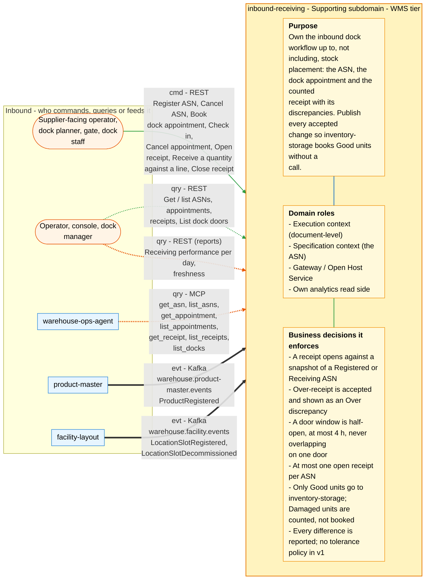
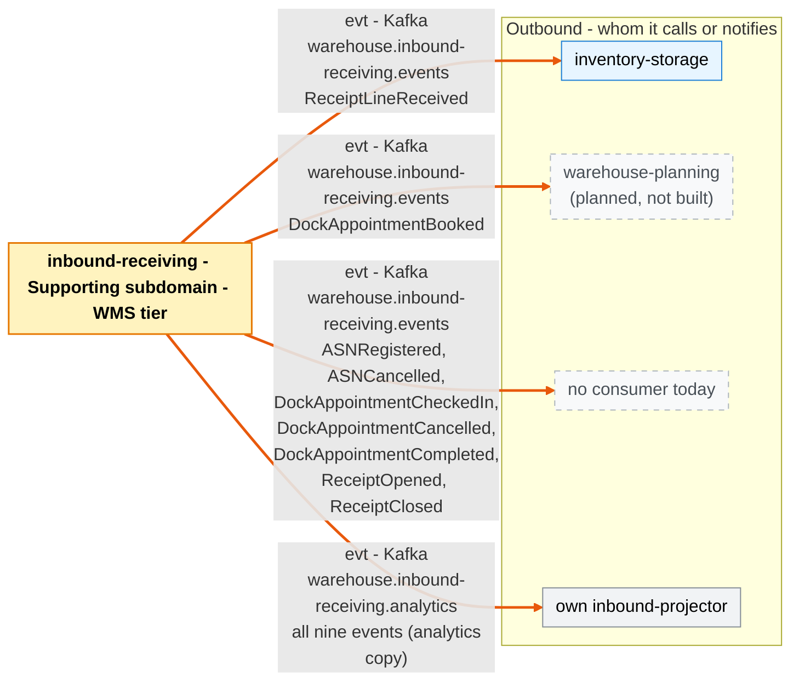

# Bounded context canvas

Following the ddd-crew [Bounded Context Canvas v5](https://github.com/ddd-crew/bounded-context-canvas).
Every message row below maps to a route in `NewRouter`
(`internal/adapters/inbound/http/server.go`) or to a topic and CloudEvents type
in `internal/adapters/inbound/kafka/{product_consumer,dock_door_consumer}.go` /
`internal/adapters/outbound/kafka/encoder.go`.

## Canvas at a glance

Two pictures of the sections below, laid out like the ddd-crew canvas:
first the inbound collaborators feeding this context (purpose, domain roles
and the business decisions it enforces), then the outbound collaborators it
calls or notifies. Arrows follow the message type: **solid blue**
commands (`cmd`), **dotted green** queries (`qry`), **thick orange** events
(`evt`); each arrow names its channel and the messages it carries. Box shapes
mark the collaborator kind: rounded = people, UI or any client; blue =
sibling bounded context; double border = external system or platform;
grey = this context's own projector, reports or dead-letter path; dashed =
published today with no consumer. Channel names on the arrows are
abbreviated (REST, MCP, Kafka, HTTP, port); the Inbound and Outbound
Communication tables carry the exact route, tool, topic and CloudEvents
type for every message.

### Inbound

### Outbound

Source: the Inbound Communication and Outbound Communication tables of this
page, which map to `internal/adapters/inbound/{http,kafka,mcp}` and `internal/adapters/outbound/`. The diagram omits assumptions, verification metrics, open
questions and the ubiquitous language (sections below), the relationship
pattern per message (OHS, ACL, Conformist, Customer/Supplier - see the
tables) and anything the tables mark as deprecated or platform-only
(health probes).

## Name

**Inbound Receiving** (`inbound-receiving`, Go module
`github.com/claudioed/inbound-receiving`, GitHub `IQVO/inbound-receiving`).

## Purpose

Own the inbound dock workflow up to, and not including, stock placement: the
supplier's announcement of a delivery (ASN), the carrier's booked door window
(dock appointment) and the counted receipt with the discrepancies found when it
closes. Publish every accepted change so `inventory-storage` can book received
Good units as staged stock without a request-time call. It answers no "where"
or "how many are in stock" question (ADR 0001).

## Strategic Classification

| Axis | Verdict | Evidence |
| --- | --- | --- |
| Domain | **Supporting** | ADR 0001 "Classification"; see the [core domain chart](/docs/ddd/core-domain-chart) |
| Business model | **Cost reduction / compliance**: an accurate receipt and discrepancy record | warehouse-docs contexts table; the receipt is the dock's source of truth for what arrived |
| Evolution | **Custom-built** (genesis) | Created 2026-10-08 (ADRs 0001-0004) |

## Domain Roles

| Role | Applies? | Notes |
| --- | --- | --- |
| Execution context | **Yes** (primary, document-level) | Dock staff record what arrived; it moves no stock itself. |
| Specification context | Partly | The ASN is the supplier's specification of what should arrive. |
| Gateway / Open Host Service | **Yes** | REST plus the `warehouse.inbound-receiving.events` Published Language. |
| Analysis context | No | Discrepancy is a per-line comparison on close. |
| Analytics / reporting | **Yes** (own read side, ADR 0006) | `cmd/inbound-projector` projects `warehouse.inbound-receiving.analytics` into a separate analytical database; `cmd/inbound-reports` serves receiving performance and freshness. |

## Inbound Communication

| Collaborator | Message | Type | Channel | Relationship |
| --- | --- | --- | --- | --- |
| Supplier-facing operator | Register ASN | Command | REST `POST /asns` (`Idempotency-Key` required) | This context is the OHS |
| Operator | Cancel ASN | Command | REST `POST /asns/{asnNumber}/cancel` | OHS |
| Dock planner | Book dock appointment | Command | REST `POST /appointments` (`Idempotency-Key` required) | OHS |
| Dock planner / gate | Check in, cancel appointment | Command | REST `POST /appointments/{appointmentId}/check-in`, `.../cancel` | OHS |
| Dock staff | Open receipt | Command | REST `POST /receipts` (`Idempotency-Key` required) | OHS |
| Dock staff | Receive a quantity against a line | Command | REST `POST /receipts/{receiptId}/lines` (`Idempotency-Key` required) | OHS |
| Dock staff | Close receipt | Command | REST `POST /receipts/{receiptId}/close` | OHS |
| Operator, console, agent | Get / list ASNs, appointments, receipts | Query | REST `GET /asns`, `/asns/{asnNumber}`, `/appointments`, `/appointments/{appointmentId}`, `/receipts`, `/receipts/{receiptId}` | OHS |
| Operator, console, agent | List known inbound dock doors | Query | REST `GET /docks` | OHS |
| `warehouse-ops-agent` | Get / list ASNs, appointments, receipts; list docks | Query | MCP (`cmd/mcp`, Streamable HTTP): `get_asn`, `list_asns`, `get_appointment`, `list_appointments`, `get_receipt`, `list_receipts`, `list_docks` | OHS, read-only (ADR 0005) |
| Dock manager, console | Receiving performance per day; projection freshness | Query | REST `GET /reports/receiving-performance`, `GET /reports/freshness` on `cmd/inbound-reports` | OHS over the analytical database (ADR 0006) |
| `product-master` | `ProductRegistered` | Event | Kafka `warehouse.product-master.events`, `com.warehouse.wms.product-master.product.ProductRegistered` | Conformist with a local copy (`known_skus`); group `PRODUCT_CONSUMER_GROUP` |
| `facility-layout` | `LocationSlotRegistered` | Event | Kafka `warehouse.facility.events`, `com.warehouse.wms.facility-layout.locationslot.LocationSlotRegistered` | Conformist with a local copy (`dock_doors`); group `DOCK_DOOR_CONSUMER_GROUP` |
| `facility-layout` | `LocationSlotDecommissioned` | Event | Kafka `warehouse.facility.events`, `com.warehouse.wms.facility-layout.locationslot.LocationSlotDecommissioned` | Conformist; same group |

No REST endpoint or MCP tool is authenticated (fleet-wide revert of 2026-09-11;
`TestNoAuthMiddlewareReintroduced` fails the build if auth middleware returns).
The MCP server is read-only: writes stay on REST.

## Outbound Communication

The context makes **no** synchronous call to any sibling and has no outbound
HTTP client (ADR 0001). Everything outbound leaves through the transactional
outbox and the relay in `cmd/api`.

| Collaborator | Message | Type | Channel | Relationship |
| --- | --- | --- | --- | --- |
| `inventory-storage` | `ReceiptLineReceived` | Event | Kafka `warehouse.inbound-receiving.events`, `com.warehouse.wms.inbound-receiving.receipt.ReceiptLineReceived` | This context upstream, OHS + Published Language; inventory-storage books `condition=Good` only (its ADR 0037) |
| none today | `ASNRegistered`, `ASNCancelled` | Event | same topic, `...asn.*` | OHS + PL |
| `warehouse-planning` (**planned, not built**) | `DockAppointmentBooked` | Event | same topic, `...dockappointment.DockAppointmentBooked` | OHS + PL; would be inbound-labor demand, needs an inbound process path in its CapacityPlan first |
| none today | `DockAppointmentCheckedIn`, `DockAppointmentCancelled`, `DockAppointmentCompleted` | Event | same topic, `...dockappointment.*` | OHS + PL |
| none today | `ReceiptOpened`, `ReceiptClosed` | Event | same topic, `...receipt.*` | OHS + PL |
| this context's own `inbound-projector` | all nine events, same `type` and `id` | Event | Kafka `warehouse.inbound-receiving.analytics` (DLQ `.dlq`), `dataschema=urn:warehouse:inbound-receiving:analytics:<EventName>:v1` | internal data stream, not an integration contract (ADR 0006) |

## Ubiquitous Language

Full glossary with code identifiers: [Ubiquitous language](/docs/ddd/ubiquitous-language).
Top terms: **ASN**, **Dock appointment**, **Door**, **Window**, **Check-in**,
**Receipt**, **Line**, **Condition** (Good / Damaged), **Discrepancy** (Short /
Over / Damaged), **Walk-in**, **Snapshot**, **Local copy**, **Version**.

## Business Decisions

1. A receipt is opened against a snapshot of the ASN; the ASN must be
   `Registered` or `Receiving` (ADR 0002).
2. Over-receipt is accepted, never refused: it is physically there, and shows as
   an `Over` discrepancy on close (ADR 0002).
3. Closing a receipt with nothing received is allowed; every line is then `Short`
   (ADR 0002).
4. A door window is half-open, at most 4 hours, may not start in the past, and
   two active appointments may not overlap on one door (ADR 0002).
5. Check-in is allowed from 30 minutes before the window starts until it ends
   (ADR 0002).
6. At most one open receipt per ASN (ADR 0002).
7. Only `Good` units are handed to `inventory-storage`; `Damaged` units are
   recorded and counted in the discrepancies but not booked, and stow stays an
   RF action there (ADR 0003).
8. Every difference is reported; there is no tolerance policy in v1 (ADR 0002).
9. SKU and door checks always read the local copies (`PRODUCT_MODE` /
   `DOCK_DOOR_MODE` are `kafka`, the only mode; ADR 0003, ADR 0011).

## Assumptions

- ASNs arrive through the REST API already structured: no EDI parsing, purchase
  orders or supplier master data here (ADR 0001).
- Consumers of the receipt events can live with the ordering caveat: receipt
  events are keyed by `asn_number`, `DockAppointmentCompleted` by
  `appointment_id`, so their relative order is not guaranteed (ADR 0004).
- The far side handles its own failures (inventory-storage skips and logs); this
  context has no compensation flow in v1 (ADR 0003).

## Verification Metrics

- Golden exact-JSON tests per published type (`TestEncoderGoldenAsnEvents`,
  `TestEncoderGoldenAppointmentEvents`, `TestEncoderGoldenReceiptEvents`,
  `internal/adapters/outbound/kafka/encoder_test.go`).
- `TestEventCatalogueMatchesContract` checks ADR 0004 against
  `apis/asyncapi.yaml`; `TestHexagonalArchitecture` enforces the layering.
- Outbox atomicity and relay delivery proven with testcontainers Postgres and
  Kafka (`TestUseCasesCommitStateAndOutboxAtomically`,
  `TestRelayRealPostgresAndKafkaPublishesCloudEventsWithTheRightTypeAndKey`,
  `TestProductConsumerEndToEnd`, `TestDockDoorConsumerEndToEnd`), plus the
  integration suites for the use-case wiring, `pgtx`, the Kafka publisher, the
  REST adapter, MCP over Streamable HTTP and the analytics read side end to end
  (`analytics_e2e_integration_test.go`).
- One open receipt per ASN proven against Postgres
  (`TestReceiptRepoAtMostOneOpenReceiptPerAsn`).
- The receiving KPIs (receipts closed, units good versus damaged,
  discrepancies by kind, receipt cycle time, dock dwell, appointment
  milestones) are served by `GET /reports/receiving-performance` (ADR 0006);
  the one business counter, `inbound_receiving.receipts.units_received` (units by `outcome`), is the only receiving figure emitted as telemetry.

## Open Questions

- When does `warehouse-planning` get an inbound process path so
  `DockAppointmentBooked` can become labor demand (planned, its own ADR there)?
- A tolerance policy for over-receipt, and a quarantine flow for Damaged units,
  are later, separately decided changes (ADR 0002, ADR 0001).
