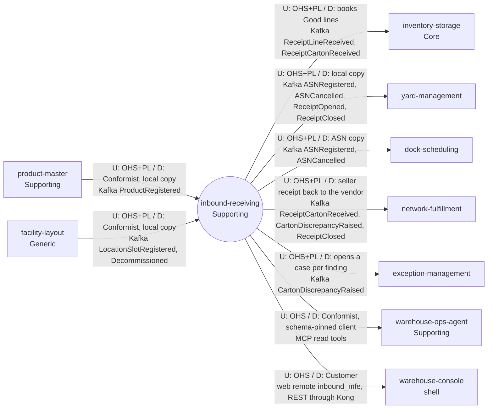

# Context map

:::caution[DockAppointment moved (ADR 0019)]
The dock appointment is owned by dock-scheduling since [ADR 0019](/docs/adr/0019-dockappointment-moves-to-dock-scheduling). This context keeps a read-only local copy fed by dock-scheduling's `DockAppointmentBooked` / `DockAppointmentCancelled` and kept current by `DockAppointmentRescheduled` / `DockAppointmentDoorReassigned` ([ADR 0020](/docs/adr/0020-appointment-copy-follows-reschedules-and-door-reassignments)), no longer books, checks in, cancels or completes appointments, and no longer raises the four `DockAppointment*` events (the one-shot `api republish-appointments` backfill that re-announced them was removed, [ADR 0022](/docs/adr/0022-stage-e-removes-the-backfill-the-legacy-encoders-and-replay)). Where this page describes those commands, rules or events, read it as the pre-transfer design; the page is not yet rewritten.
:::

This context's slice of the fleet map, following ddd-crew
[Context Mapping](https://github.com/ddd-crew/context-mapping). Every edge is
labelled `U` (upstream) / `D` (downstream) with the pattern on each side and the
technology. Solid edges are live in code on `develop` of both sides. Every edge below is solid. Neighbour classifications come from the
warehouse-docs contexts table.

Source: `docs/adr/0001-inbound-receiving-bounded-context.md` (Context map),
`docs/adr/0003-local-copies-and-handover.md`,
`docs/adr/0005-mcp-server-adoption.md`,
`internal/adapters/inbound/kafka/product_consumer.go`,
`internal/adapters/inbound/kafka/dock_door_consumer.go`,
`internal/adapters/outbound/kafka/encoder.go`, `cmd/api/main.go`, `cmd/mcp`,
`web/vite.config.ts`; on the consumer side (on `develop`) inventory-storage
`internal/adapters/inbound/kafka/inbound_receipt_consumer.go` and its ADR 0037,
yard-management `internal/adapters/inbound/kafka/inbound_receiving_consumer.go`, dock-scheduling `internal/adapters/inbound/kafka/asn_consumer.go`, network-fulfillment `internal/adapters/inbound/kafka/receipt_consumer.go`, exception-management `internal/adapters/inbound/kafka/carton_discrepancy_consumer.go`, warehouse-ops-agent ADR 0021 and warehouse-console
`vite.config.ts`.
Omits: the Kafka broker, Kong, the operators who call the REST API directly and
the internal analytics stream (its only consumer is this context's own
projector, ADR 0006).

## Relationships

| # | Upstream | Downstream | Patterns (U / D) | Technology | Status | Evidence |
| --- | --- | --- | --- | --- | --- | --- |
| 1 | `product-master` | `inbound-receiving` | OHS + Published Language / **Conformist** with a local copy: only existence matters, so the copy is the `known_skus` table | Kafka `warehouse.product-master.events`, `com.warehouse.wms.product-master.product.ProductRegistered` | **Live**, always on (`PRODUCT_MODE=kafka` is the only mode, ADR 0011) with a required `PRODUCT_CONSUMER_GROUP` | `product_consumer.go`, ADR 0003 |
| 2 | `facility-layout` | `inbound-receiving` | OHS + PL / **Conformist** with a local copy: the payload is the camelCase domain event struct taken as published; only `role=Dock` with `dockFlow` `Inbound` or `Both` is kept in `dock_doors` | Kafka `warehouse.facility.events`, `...facility-layout.locationslot.LocationSlotRegistered` and `...LocationSlotDecommissioned` | **Live**, always on (`DOCK_DOOR_MODE=kafka` is the only mode, ADR 0011) with a required `DOCK_DOOR_CONSUMER_GROUP` | `dock_door_consumer.go`, ADR 0003 |
| 3 | `inbound-receiving` | `inventory-storage` | OHS + PL / books `condition=Good` lines through its existing ReceiveStock use case; event-driven, no synchronous call in either direction, no acknowledgement event back | Kafka `warehouse.inbound-receiving.events`, `com.warehouse.wms.inbound-receiving.receipt.ReceiptLineReceived` and `...receipt.ReceiptCartonReceived` | **Live**, always on: `INBOUND_RECEIPT_CONSUMER_GROUP` is required on the inventory-storage side (boot error if unset, its ADR 0042) | inventory-storage ADR 0037, `inbound_receipt_consumer.go`, `cmd/inventory/config.go` |
| 4 | `inbound-receiving` | `yard-management`, `dock-scheduling`, `network-fulfillment`, `exception-management` | OHS + PL / each consumer keeps what it needs and dispatches on the full `type` (yard-management and dock-scheduling a local copy of ASNs and receipts, network-fulfillment the seller receipt, exception-management one case per carton finding) | Kafka `warehouse.inbound-receiving.events`: `...asn.ASNRegistered`, `...asn.ASNCancelled`, `...receipt.ReceiptOpened`, `...receipt.ReceiptCartonReceived`, `...receipt.CartonDiscrepancyRaised`, `...receipt.ReceiptClosed` | **Live**, always on; groups `INBOUND_RECEIVING_CONSUMER_GROUP` (yard-management), `ASN_CONSUMER_GROUP` (dock-scheduling), `INBOUND_RECEIPT_CONSUMER_GROUP` (network-fulfillment), `CARTON_DISCREPANCY_CONSUMER_GROUP` (exception-management) | `inbound_receiving_consumer.go`, `asn_consumer.go`, `receipt_consumer.go`, `carton_discrepancy_consumer.go` in the consumers' repos |
| 5 | `inbound-receiving` | `warehouse-ops-agent` | OHS (read-only MCP tools) / Conformist through a schema-pinned MCP client | MCP over Streamable HTTP (`cmd/mcp`, `:8090`) | **Live**, opt-in by `INBOUND_RECEIVING_MCP_ENDPOINT` on the agent side (unset = disabled; warehouse-infra `helm-values/warehouse-ops-agent.yaml` sets it to this context's `cmd/mcp` service) | ADR 0005; warehouse-ops-agent ADR 0021 |
| 6 | `inbound-receiving` | `warehouse-console` | OHS / Customer: the shell mounts this repo's `inbound_mfe` remote at `/inbound-receiving/*`, which calls REST through Kong | Module Federation remote (`web/`) + REST | **Live** | `web/vite.config.ts`; warehouse-console `vite.config.ts`, `src/App.tsx` |

`ReceiptStowCompleted` is the one published type with no consumer on `develop`
of any sibling today (the other seven are read by the siblings in rows 3 and 4).
`warehouse-planning` no longer reads this topic: its inbound labour demand comes
from dock-scheduling (`INBOUND_DEMAND_CONSUMER_GROUP` is retired there), and no
sibling's dispatch code reads the four `dockappointment.DockAppointment*` types
this context stopped raising (ADR 0022).

There is no Shared Kernel and no Partnership: no sibling Go package is imported
(the consumed payloads are restated locally), and the published payloads are the
only shared contract. `inbound-receiving` calls no sibling at request time, and
no context calls it at request time (ADR 0001). The MCP and console edges are
read paths used by an agent and a UI shell, not by a bounded context.
