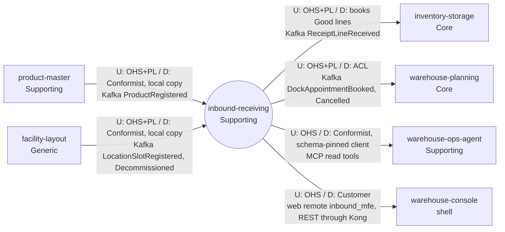

# Context map

This context's slice of the fleet map, following ddd-crew
[Context Mapping](https://github.com/ddd-crew/context-mapping). Every edge is
labelled `U` (upstream) / `D` (downstream) with the pattern on each side and the
technology. Solid edges are live in code on `develop` of both sides. Every edge below is solid since
warehouse-planning ADR 0017 closed the last planned one. Neighbour classifications come from the
warehouse-docs contexts table.

Source: `docs/adr/0001-inbound-receiving-bounded-context.md` (Context map),
`docs/adr/0003-local-copies-and-handover.md`,
`docs/adr/0005-mcp-server-adoption.md`,
`internal/adapters/inbound/kafka/product_consumer.go`,
`internal/adapters/inbound/kafka/dock_door_consumer.go`,
`internal/adapters/outbound/kafka/encoder.go`, `cmd/api/main.go`, `cmd/mcp`,
`web/vite.config.ts`; on the consumer side (on `develop`) inventory-storage
`internal/adapters/inbound/kafka/inbound_receipt_consumer.go` and its ADR 0037,
warehouse-planning `internal/adapters/inbound/kafka/inbound_demand_consumer.go`
and its ADR 0017, warehouse-ops-agent ADR 0021 and warehouse-console
`vite.config.ts`.
Omits: the Kafka broker, Kong, the operators who call the REST API directly and
the internal analytics stream (its only consumer is this context's own
projector, ADR 0006).

## Relationships

| # | Upstream | Downstream | Patterns (U / D) | Technology | Status | Evidence |
| --- | --- | --- | --- | --- | --- | --- |
| 1 | `product-master` | `inbound-receiving` | OHS + Published Language / **Conformist** with a local copy: only existence matters, so the copy is the `known_skus` table | Kafka `warehouse.product-master.events`, `com.warehouse.wms.product-master.product.ProductRegistered` | **Live**, always on (`PRODUCT_MODE=kafka` is the only mode, ADR 0011) with a required `PRODUCT_CONSUMER_GROUP` | `product_consumer.go`, ADR 0003 |
| 2 | `facility-layout` | `inbound-receiving` | OHS + PL / **Conformist** with a local copy: the payload is the camelCase domain event struct taken as published; only `role=Dock` with `dockFlow` `Inbound` or `Both` is kept in `dock_doors` | Kafka `warehouse.facility.events`, `...facility-layout.locationslot.LocationSlotRegistered` and `...LocationSlotDecommissioned` | **Live**, always on (`DOCK_DOOR_MODE=kafka` is the only mode, ADR 0011) with a required `DOCK_DOOR_CONSUMER_GROUP` | `dock_door_consumer.go`, ADR 0003 |
| 3 | `inbound-receiving` | `inventory-storage` | OHS + PL / books `condition=Good` lines through its existing ReceiveStock use case; event-driven, no synchronous call in either direction, no acknowledgement event back | Kafka `warehouse.inbound-receiving.events`, `com.warehouse.wms.inbound-receiving.receipt.ReceiptLineReceived` | **Live**, always on: `INBOUND_RECEIPT_CONSUMER_GROUP` is required on the inventory-storage side (boot error if unset, its ADR 0042) | inventory-storage ADR 0037, `inbound_receipt_consumer.go`, `cmd/inventory/config.go` |
| 4 | `inbound-receiving` | `warehouse-planning` | OHS + PL / ACL (as its other event consumers): hand-mirrored payload structs, dispatch on the full `type`, a bad payload is dead-lettered | Kafka `warehouse.inbound-receiving.events`, `...dockappointment.DockAppointmentBooked` and `...DockAppointmentCancelled` | **Live**, always on: `INBOUND_DEMAND_CONSUMER_GROUP` is required on the warehouse-planning side and warehouse-infra pins `warehouse-planning-inbound-demand`. Replaces the earlier "planned, not built" status; nothing here depends on it | warehouse-planning ADR 0017, `inbound_demand_consumer.go`, `cmd/api/runtime.go` |
| 5 | `inbound-receiving` | `warehouse-ops-agent` | OHS (read-only MCP tools) / Conformist through a schema-pinned MCP client | MCP over Streamable HTTP (`cmd/mcp`, `:8090`) | **Live**, opt-in by `INBOUND_RECEIVING_MCP_ENDPOINT` on the agent side (unset = disabled; warehouse-infra `helm-values/warehouse-ops-agent.yaml` sets it to this context's `cmd/mcp` service) | ADR 0005; warehouse-ops-agent ADR 0021 |
| 6 | `inbound-receiving` | `warehouse-console` | OHS / Customer: the shell mounts this repo's `inbound_mfe` remote at `/inbound-receiving/*`, which calls REST through Kong | Module Federation remote (`web/`) + REST | **Live** | `web/vite.config.ts`; warehouse-console `vite.config.ts`, `src/App.tsx` |

The other published types (`ASNRegistered`, `ASNCancelled`,
`DockAppointmentCheckedIn`, `DockAppointmentCompleted`, `ReceiptOpened`,
`ReceiptClosed`) have no consumer on `develop` of any sibling today:
inventory-storage reads only `ReceiptLineReceived` and commits past the rest
(`inbound_receipt_consumer.go`), and warehouse-planning reads only
`DockAppointmentBooked` and `DockAppointmentCancelled`, committing past
`DockAppointmentCheckedIn` and `DockAppointmentCompleted`
(`inbound_demand_consumer.go`).

There is no Shared Kernel and no Partnership: no sibling Go package is imported
(the consumed payloads are restated locally), and the published payloads are the
only shared contract. `inbound-receiving` calls no sibling at request time, and
no context calls it at request time (ADR 0001). The MCP and console edges are
read paths used by an agent and a UI shell, not by a bounded context.
