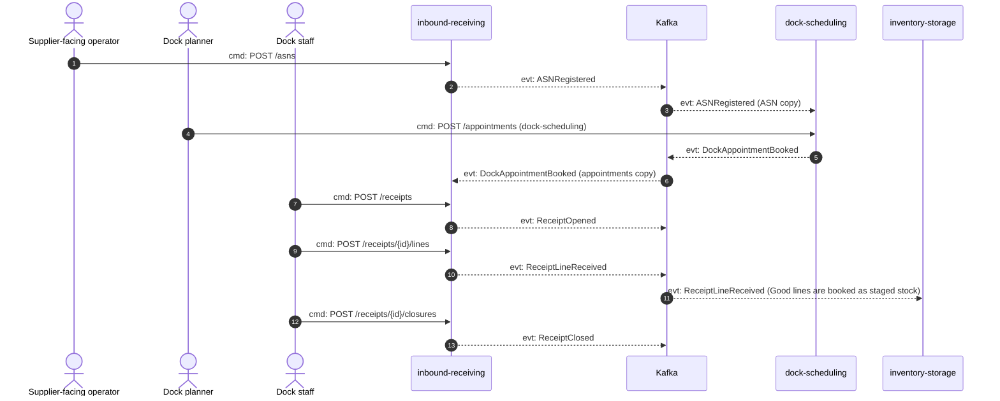
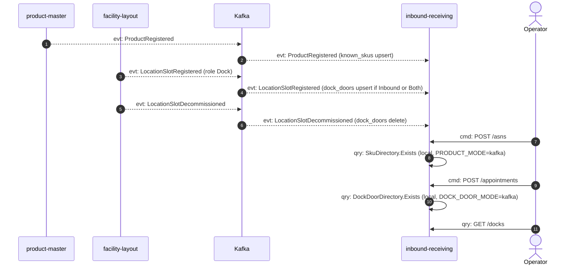
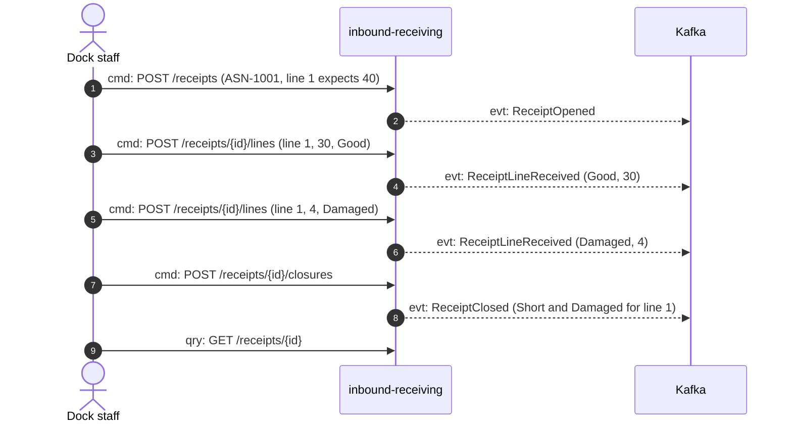

# Domain message flow

:::caution[DockAppointment moved (ADR 0019)]
The dock appointment is owned by dock-scheduling since [ADR 0019](/docs/adr/0019-dockappointment-moves-to-dock-scheduling). This context keeps a read-only local copy fed by dock-scheduling's `DockAppointmentBooked` / `DockAppointmentCancelled`, no longer books, checks in, cancels or completes appointments, and no longer raises the four `DockAppointment*` events (the one-shot `api republish-appointments` backfill that re-announced them was removed, [ADR 0022](/docs/adr/0022-stage-e-removes-the-backfill-the-legacy-encoders-and-replay)). Where this page describes those commands, rules or events, read it as the pre-transfer design; the page is not yet rewritten.
:::

Following ddd-crew [Domain Message Flow Modelling](https://github.com/ddd-crew/domain-message-flow-modelling).
Arrows are prefixed `cmd:` (command), `evt:` (event) or `qry:` (query), and only
real messages appear: REST routes from `NewRouter`, CloudEvents types from
`apis/asyncapi.yaml`.

## Scenario 1: a delivery announced, appointed, received and handed over

Source: `internal/adapters/inbound/http/server.go`,
`internal/application/usecases/{asn,receipt,consumers_appointment}.go`,
`internal/adapters/outbound/kafka/encoder.go`, inventory-storage
`internal/adapters/inbound/kafka/inbound_receipt_consumer.go`, dock-scheduling
`internal/adapters/inbound/kafka/asn_consumer.go`.
Omits: the outbox relay hop between the use case and Kafka (every `evt:` this
context raises leaves through `outbox_events`), the repeated `ReceiveLine` calls,
the scan path (`ReceiptCartonReceived`, `CartonDiscrepancyRaised`), the gate
check-in and the dock-to-stock fact (`ReceiptStowCompleted`, ADR 0021), and the
cancel paths. This context raises no appointment event: the four
`dockappointment.DockAppointment*` types it used to raise were retired by
[ADR 0022](/docs/adr/0022-stage-e-removes-the-backfill-the-legacy-encoders-and-replay),
and `DockAppointmentBooked` here is dock-scheduling's own message.

## Scenario 2: the local copies behind the SKU and door checks

Source: `internal/adapters/inbound/kafka/{product_consumer,dock_door_consumer}.go`,
`internal/application/usecases/{consumers,asn,appointment,queries}.go`.
Omits: the `processed_events` claim and offset commits (see the
[sequence diagrams](/docs/ddd/sequence-diagrams)). The two `qry:` rows are
in-process port calls, not messages to a sibling.

## Scenario 3: a short and damaged delivery, with the discrepancy report

Source: `Receipt.ReceiveLine` and `Receipt.Close` in
`internal/domain/receipt/receipt.go`; the numbers follow the `closeReceipt`
example in `apis/openapi.yaml`. Line 1 ends with `received_qty` 34 (30 good plus
4 damaged), so `Close` raises `Short` and `Damaged` for it, in that order.
