# Entity-relationship diagram

The final schemas after all migrations. There are **two** Postgres databases:

- the **OLTP** database (`DATABASE_URL`): migrations `0001_inbound_receiving`
  to `0004_receipt_carton_discrepancies`, applied at start-up;
- the separate **analytical** database (`ANALYTICS_DATABASE_URL`,
  `inbound_receiving_analytics`): `analytics/migrations/0001_receiving_performance`,
  written only by `cmd/inbound-projector` and read (read-only) by
  `cmd/inbound-reports` (ADR 0006).

A relationship line is drawn **only where a real `FOREIGN KEY` exists**;
logical links without one are described in prose below.

## OLTP database

```mermaid
erDiagram
  asns ||--|{ asn_lines : "FK asn_number"
  asns ||--o{ receipts : "FK asn_number"
  asns ||--|{ asn_cartons : "FK asn_number, ON DELETE CASCADE"
  asn_cartons ||--|{ asn_carton_contents : "FK asn_number + sscc, ON DELETE CASCADE"
  asn_lines ||--|{ asn_carton_contents : "FK asn_number + line_no"
  appointments ||--|{ appointment_asns : "FK appointment_id"
  receipts ||--|{ receipt_lines : "FK receipt_id"
  receipts ||--|{ receipt_cartons : "FK receipt_id, ON DELETE CASCADE"
  receipts ||--|{ receipt_carton_discrepancies : "FK receipt_id, ON DELETE CASCADE"

  asns {
    text asn_number PK
    text supplier_ref
    timestamptz expected_arrival
    text state
    bigint version
    timestamptz created_at
    timestamptz updated_at
    text owner_ref "0003, nullable; NULL = fleet-owned stock"
  }
  asn_lines {
    text asn_number PK
    int line_no PK
    text sku
    bigint expected_qty
  }
  appointments {
    text id PK
    text door_code
    text carrier
    timestamptz window_start
    timestamptz window_end
    text state
    bigint version
    timestamptz created_at
    timestamptz updated_at
  }
  appointment_asns {
    text appointment_id PK
    int position PK
    text asn_number
  }
  receipts {
    text id PK
    text asn_number
    text appointment_id
    text door_code
    text state
    timestamptz opened_at
    timestamptz closed_at
    bigint version
    timestamptz created_at
    timestamptz updated_at
    text owner_ref "0003, nullable; NULL = fleet-owned stock"
  }
  receipt_cartons {
    text receipt_id PK
    int position PK "CHECK at least 1"
    text lpn "manifest carton: lpn = sscc; case by GTIN: internal LPN"
    text sscc "nullable, 18 digits"
    text parent_sscc "nullable, 18 digits"
    text kind "HOMOGENEOUS_CASE or MIXED"
    text status "Expected or Accepted"
    boolean sealed
    jsonb contents
    timestamptz received_at "nullable; set exactly when Accepted"
  }
  receipt_carton_discrepancies {
    text receipt_id PK
    int position PK "raise order on the receipt, 0004"
    text kind "UnexpectedCarton, MissingCarton, DuplicateSscc, UnknownGtin, CaseQtyMismatch, MixedCaseDeclaredAsCasePack, UnlabelledCarton, CartonOverLimit, MixedCartonContentMismatch"
    text sscc "nullable; NULL when the finding is not about a scanned SSCC"
    text expected "nullable"
    text actual "nullable"
    timestamptz raised_at
  }
  asn_cartons {
    text asn_number PK
    int position PK "announced order, CHECK at least 1, 0003"
    text sscc "18 digits; unique per site while active"
    text parent_sscc "nullable; a pallet is only an SSCC its cartons reference"
    text kind "HOMOGENEOUS_CASE or MIXED"
    bigint gross_weight_g "nullable, CHECK at least 1"
    bigint length_mm "nullable; the three dims set together or not at all"
    bigint width_mm "nullable"
    bigint height_mm "nullable"
    boolean active "false once the ASN is cancelled"
  }
  asn_carton_contents {
    text asn_number PK
    text sscc PK
    int position PK "CHECK at least 1"
    int line_no "rolls up into asn_lines"
    text sku
    text gtin "14 digits"
    bigint qty "eaches, CHECK 1..2147483647"
    text lot "nullable"
    text expiry "nullable"
  }
  pack_levels {
    text gtin PK "14 digits, 0003"
    text sku
    text level "EACH, INNER, CASE, PALLET"
    text child_gtin "nullable, 14 digits"
    bigint qty_of_child
    bigint units_per_pack "CHECK 1..2147483647"
    timestamptz effective_from
    timestamptz effective_to "nullable; a retired level keeps its row"
    bigint version "producer aggregate version"
    timestamptz updated_at
  }
  receipt_lines {
    text receipt_id PK
    int line_no PK
    text sku
    bigint expected_qty
    bigint received_good
    bigint received_damaged
  }
  known_skus {
    text sku PK
    timestamptz first_seen_at
  }
  dock_doors {
    text door_code PK
    text dock_flow
    timestamptz updated_at
  }
  outbox_events {
    bigserial id PK
    text event_id
    text topic
    text event_type
    text subject
    bytea key
    text dataschema
    bytea value
    jsonb headers
    timestamptz created_at
    timestamptz published_at
    int attempts
    text last_error
  }
  processed_events {
    text consumer PK
    text event_id PK
    timestamptz processed_at
  }
  idempotency_keys {
    text key PK
    text request_hash
    int status_code
    bytea response_body
    jsonb response_headers
    timestamptz created_at
    timestamptz completed_at
  }
```

Source: `internal/adapters/outbound/postgres/migrations/0001_inbound_receiving.up.sql`
through `0004_receipt_carton_discrepancies.up.sql` (`0002` adds housekeeping
indexes only and changes no table).
Omits: `CHECK` constraints and indexes (listed below), the `"C"` collation on the
text identifiers, and `schema_migrations` (golang-migrate's own table).

## Table to aggregate

"Table is not aggregate": the mapping is not one to one.

| Table | Role | Backs |
| --- | --- | --- |
| `asns`, `asn_lines` | domain | the `Asn` aggregate (root row plus its lines) |
| `appointments`, `appointment_asns` | domain | the `DockAppointment` aggregate (root row plus the ASN numbers it covers, in booking order) |
| `receipts`, `receipt_lines` | domain | the `Receipt` aggregate (root row plus the snapshot of the ASN's lines and the two counters) |
| `receipt_cartons` | domain | the receipt's carton ledger (ADR 0012): manifest cartons plus cases received by GTIN; part of the `Receipt` read model |
| `receipt_carton_discrepancies` | domain | the carton discrepancies raised on a receipt (ADR 0015); append-only, part of the `Receipt` read model |
| `asn_cartons`, `asn_carton_contents` | domain | the hierarchical ASN's announced SSCC cartons and their contents (ADR 0013), rolling up into `asn_lines` |
| `pack_levels` | local copy | the PackagingView, projection of product-master's `ProductPackLevelDeclared` / `ProductPackLevelRetired` (contracts R8) |
| `known_skus`, `dock_doors` | local copy | read models fed by `ProductRegistered` and the facility-layout slot events; not an aggregate |
| `outbox_events` | infrastructure | the transactional outbox (unique `(event_id, topic)`; partial index on unpublished rows) |
| `processed_events` | infrastructure | idempotency guard of the consumers, primary key `(consumer, event_id)` |
| `idempotency_keys` | infrastructure | the `Idempotency-Key` middleware's store |

## Where there is no foreign key, on purpose

- `appointment_asns.asn_number` has no FK to `asns`: `Asn` and `DockAppointment`
  are separate aggregates that reference each other by id. The book use case
  checks the ASNs exist and are receivable inside the unit of work.
- `receipts.appointment_id` and `receipts.door_code` have no FK to
  `appointments`: a walk-in receipt has neither, and the appointment is a
  separate aggregate. `receipts.asn_number` **does** have an FK to `asns`.
- `known_skus` is deliberately existence-only (`sku`, `first_seen_at`): there is
  no foreign key from `asn_lines.sku` or `receipt_lines.sku` to it, because the
  copy is only consulted in `kafka` mode.
- `asn_cartons.parent_sscc` references another carton of the same ASN only by
  value: a pallet is not a row, just the SSCC its cartons name.
- `pack_levels` has deliberately no constraint beyond the shape the consumer
  has already validated, and no foreign key from `asn_carton_contents.gtin`:
  a violated constraint on the consumer path would be retried forever.
- `receipt_cartons.lpn` / `receipt_carton_discrepancies.sscc` name labels and
  findings of other contexts by value; the carton ledger's only real keys are
  the ones drawn above.

## Constraints that carry domain rules

| Constraint | Rule |
| --- | --- |
| `receipts_one_open_per_asn` (unique, partial on `state = 'Open'`) | at most one open receipt per ASN (ADR 0002) |
| `UNIQUE (asn_number, sku)` on `asn_lines` | SKUs unique across an ASN's lines |
| `UNIQUE (appointment_id, asn_number)` on `appointment_asns` | an ASN is covered once per appointment |
| `CHECK (window_end > window_start)` on `appointments` | the window ends after it starts |
| `CHECK ((state = 'Closed') = (closed_at IS NOT NULL))` on `receipts` | `closed_at` is set exactly when closed |
| `CHECK (received_good + received_damaged <= 2147483647)` on `receipt_lines` | the per-line total stays within the quantity bound |
| `CHECK (version >= 1)` on the aggregate roots | version starts at 1 |
| `idx_appointments_active_door` (partial on `Booked`, `CheckedIn`) | serves the overlap read of one door |
| `outbox_events_event_id_topic_key` | a relay retry never duplicates a row |
| `asn_cartons_active_sscc` (unique, partial on `active`) | an announced SSCC is unique per site until the ASN is cancelled |
| `receipt_cartons_accepted_sscc` (unique, partial on `Accepted` with an SSCC) | an SSCC is accepted once per site; a second acceptance is a `DuplicateSscc` |
| `CHECK ((status = 'Accepted') = (received_at IS NOT NULL))` on `receipt_cartons` | the scan instant is set exactly when the carton is accepted |
| `UNIQUE (asn_number, sscc)` on `asn_cartons` and `UNIQUE (receipt_id, lpn)` on `receipt_cartons` | a carton is announced once per ASN and received once per receipt |

## Analytical database

A separate database (`ANALYTICS_DATABASE_URL`, `inbound_receiving_analytics`),
written only by `cmd/inbound-projector` and read (read-only) by
`cmd/inbound-reports` (ADR 0006). Everything here is a projection derived from
`warehouse.inbound-receiving.analytics`, not a source of truth: it can be
dropped and rebuilt by replaying the topic under a new consumer group. Facts,
not aggregates: each milestone column is the CloudEvents `time` of the
**earliest** such event seen (kept with `LEAST`, which ignores NULLs), so
arrival order never matters. There are no foreign keys in this database.

```mermaid
erDiagram
  analytics_processed_events {
    text event_id PK "every applied CloudEvents id, claimed in the same transaction as its effect"
    text event_type
    timestamptz occurred_at "indexed; max() is the projection's freshness"
    timestamptz applied_at
  }
  asn_facts {
    text asn_number PK
    timestamptz expected_arrival "nullable, from ASNRegistered"
    timestamptz registered_at "nullable"
    timestamptz cancelled_at "nullable"
    timestamptz receipt_opened_at "nullable; earliest ReceiptOpened of any receipt of the ASN"
  }
  appointment_facts {
    text appointment_id PK
    timestamptz booked_at "nullable"
    timestamptz checked_in_at "nullable"
    timestamptz cancelled_at "nullable"
    timestamptz completed_at "nullable"
  }
  receipt_facts {
    text receipt_id PK
    text asn_number
    timestamptz opened_at "nullable"
    timestamptz closed_at "nullable; OPEN while opened and not closed"
  }
  receipt_line_events {
    text event_id PK "one row per ReceiptLineReceived"
    text receipt_id
    int line_no "CHECK at least 1"
    text sku
    bigint quantity "CHECK at least 1"
    text condition "Good or Damaged"
    timestamptz occurred_at
  }
  receipt_discrepancies {
    text receipt_id PK
    int line_no PK
    text kind PK "Short, Over, Damaged"
    text sku
    timestamptz closed_at
  }
```

Source: `analytics/migrations/0001_receiving_performance.up.sql`.
Omits: the partial milestone indexes (one per nullable milestone column) and
`schema_migrations`.
