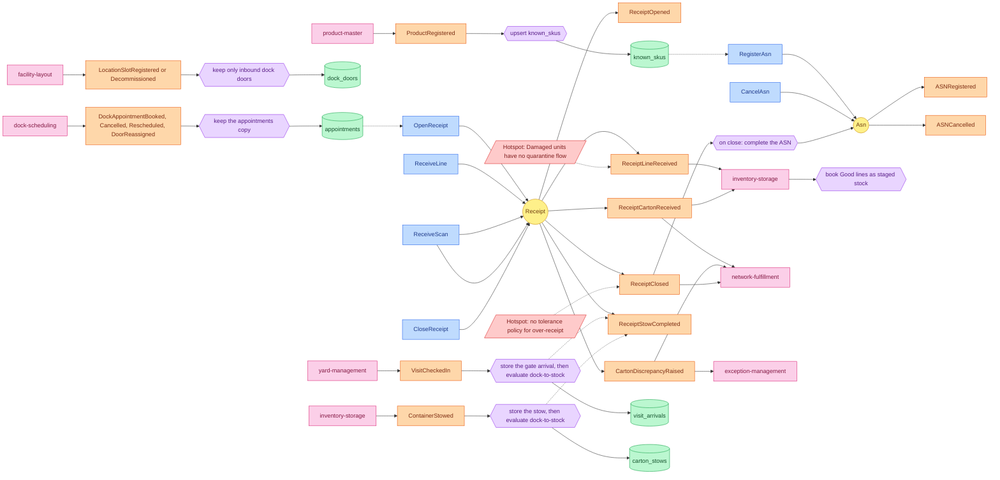

# EventStorming

:::caution[DockAppointment moved (ADR 0019)]
The dock appointment is owned by dock-scheduling since [ADR 0019](/docs/adr/0019-dockappointment-moves-to-dock-scheduling). This context keeps a read-only local copy fed by dock-scheduling's `DockAppointmentBooked` / `DockAppointmentCancelled`, no longer books, checks in, cancels or completes appointments, and no longer raises the four `DockAppointment*` events (the one-shot `api republish-appointments` backfill that re-announced them was removed, [ADR 0022](/docs/adr/0022-stage-e-removes-the-backfill-the-legacy-encoders-and-replay)). Where this page describes those commands, rules or events, read it as the pre-transfer design; the page is not yet rewritten.
:::

Design-level EventStorming following the ddd-crew
[EventStorming glossary and cheat sheet](https://github.com/ddd-crew/eventstorming-glossary-cheat-sheet).
This is a reconstruction from the code on `develop`, not a workshop output.

Sticky colours: **Command** blue, **Aggregate** yellow, **Domain event** orange,
**Policy** lilac, **Read model** green, **External system** pink, **Hotspot**
red.

Source: `internal/application/usecases/*.go`, `internal/domain/*/events.go`,
`internal/adapters/inbound/kafka/*.go`; inventory-storage
`internal/adapters/inbound/kafka/inbound_receipt_consumer.go`; the other consumers are listed on [Domain events](/docs/ddd/domain-events). The four `dockappointment.DockAppointment*` events this context once raised are not drawn: ADR 0022 retired them.
Omits: the internal `BeginReceiving` and `Complete` transitions of the ASN
(they raise no event) and error branches.

## Legend

| Sticky | Meaning here |
| --- | --- |
| Command | A use case in `internal/application/usecases`, reached by a REST `POST`. |
| Aggregate | `Asn` and `Receipt` in `internal/domain` raise events; `DockAppointment` (`internal/domain/appointment`) only holds the local copy's state and raises none (ADR 0022). |
| Domain event | A type in `apis/asyncapi.yaml`, raised by the aggregate and published through the outbox. |
| Policy | Reactive logic: `CloseReceipt` completing the ASN (in the same unit of work), the six local-copy consumers and the sibling consumers of the published events. |
| Read model | The local-copy tables `known_skus`, `dock_doors`, `appointments`, `visit_arrivals` and `carton_stows`. |
| External system | `product-master`, `facility-layout`, `dock-scheduling`, `yard-management`, `inventory-storage`, `network-fulfillment`, `exception-management`. |

## Hotspots

Taken from real gaps in the ADRs, not invented:

1. **No tolerance policy.** v1 reports every difference; accepting up to x %
   over-receipt silently is "a later, separately decided change" (ADR 0002).
2. **Damaged units have no quarantine flow.** They are recorded and counted but
   not booked as stock; "a quarantine flow is a later ADR" (ADR 0001, ADR 0003).
3. **No compensation on the far side.** If `inventory-storage` rejects a line it
   skips and logs; the receipt's counts stay the source of truth (ADR 0003).
4. **Eventually consistent local copies.** The copies are always enforced
   (ADR 0011 retired the `permissive` fail-open of ADR 0001): a fresh deploy
   answers `422` until the consumers have replayed.
5. **`ReceiptStowCompleted` has no consumer yet.** It is published and folded by this context's own projector only (ADR 0021).
