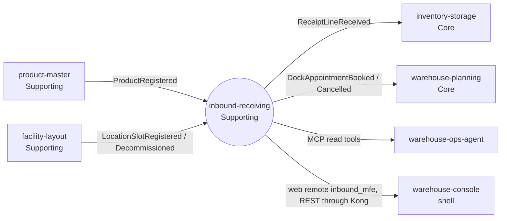

# Bounded context

## Purpose

`inbound-receiving` owns the inbound dock workflow: a supplier announces a
delivery (ASN), a carrier books a door window for it (dock appointment), and
dock staff count what actually arrives (receipt). When a receipt closes it
reports every difference against the announcement. Each counted line is
published once, as a CloudEvent, so `inventory-storage` can book the Good units
as staged stock without this service ever calling it.

Before this context existed there was nothing between "a truck is announced"
and "units are staged in `inventory-storage`": its `POST /stock/receive` is a
bare quantity acknowledgement that does not know which delivery the units
belong to, whether the delivery was announced, who booked which door, or what
was short, over or damaged. [ADR 0001](/docs/adr/0001-inbound-receiving-bounded-context)
puts that announce, appoint, receive, reconcile chain in its own context
because a transactional document workflow changes for different reasons and at a
different cadence than the stock ledger.

## Context map

Source: `docs/adr/0001-inbound-receiving-bounded-context.md` (Context map),
`docs/adr/0003-local-copies-and-handover.md`,
`docs/adr/0005-mcp-server-adoption.md`,
`internal/adapters/inbound/kafka/{product_consumer,dock_door_consumer}.go`,
`internal/adapters/outbound/kafka/encoder.go`, `web/vite.config.ts`; on the
consumer side (on `develop`) inventory-storage
`internal/adapters/inbound/kafka/inbound_receipt_consumer.go` and its ADR 0037,
warehouse-planning `internal/adapters/inbound/kafka/inbound_demand_consumer.go`
and its ADR 0017, warehouse-ops-agent ADR 0021 (`INBOUND_RECEIVING_MCP_ENDPOINT`)
and warehouse-console `vite.config.ts` (remote `inbound_mfe`).
Omits: the Kafka broker, the internal analytics stream (consumed only by this
context's own projector) and the patterns on each edge (see the
[context map](/docs/ddd/context-map) for those). The edge to
`warehouse-planning` is built and live: its `inbound-demand` consumer
(`warehouse-planning-inbound-demand`, ADR 0017) reads `DockAppointmentBooked`
and `DockAppointmentCancelled` from `warehouse.inbound-receiving.events` into
its local `inbound_appointments` read model as inbound-labour demand. This
repository never calls it and does not depend on it being up.

## No live cross-context lookup, in either direction

- `inbound-receiving` never calls a sibling context at request time. It has no
  outbound HTTP client: the only outbound adapters are Postgres, the Kafka
  relay sink, the clock and the id generator. "Does this SKU exist" and "is
  this an inbound dock door" are answered from local copies (`known_skus`,
  `dock_doors`) fed by events ([ADR 0003](/docs/adr/0003-local-copies-and-handover)).
- No bounded context calls `inbound-receiving` at request time either. Its
  read surfaces serve people and agents, not sibling contexts: the REST `GET`
  endpoints back operators and the `inbound_mfe` console remote, the read-only
  MCP tools back `warehouse-ops-agent`, and the reports endpoints answer from
  the analytical database, never from the OLTP one.

## Local copies are always enforced

`PRODUCT_MODE` and `DOCK_DOOR_MODE` are `kafka` (the default and the only legal
value since [ADR 0011](/docs/adr/0011-postgres-and-kafka-are-the-only-runtime)):
the copies are always consulted. An unknown SKU is `422 unknown-sku` and an
unknown door `422 unknown-dock-door`, including right after a fresh deploy
until the consumers have replayed the source topics (the earlier `permissive`
fail-open of ADR 0001 is gone).

## Out of scope

Yard and trailer management (an appointment ends at the door), returns,
putaway directives (stow stays an RF action in `inventory-storage`), quality
inspection and quarantine (Damaged units are recorded on the receipt and not
booked as stock), supplier master data, purchase orders and EDI parsing.
