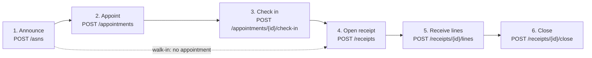

# Receiving workflow

The dock workflow in four steps. Each step is a REST call; the events are
written to the transactional outbox in the same transaction as the change and
published by the relay.

Source: `internal/adapters/inbound/http/server.go` (routes),
`internal/application/usecases/{asn,appointment,receipt}.go`.
Omits: cancel paths and the read endpoints.

| Step | Use case | State change | Event |
| --- | --- | --- | --- |
| Announce | `RegisterAsn` | ASN `Registered` | `ASNRegistered` |
| Appoint | `BookAppointment` | appointment `Booked` | `DockAppointmentBooked` |
| Check in | `CheckInAppointment` | appointment `CheckedIn` | `DockAppointmentCheckedIn` |
| Open | `OpenReceipt` | receipt `Open`, ASN `Registered -> Receiving` | `ReceiptOpened` (the ASN transition raises none) |
| Receive | `ReceiveLine` | line counters grow | `ReceiptLineReceived` per call |
| Close | `CloseReceipt` | receipt `Closed`, ASN `Closed`, appointment `Completed` | `ReceiptClosed`, and `DockAppointmentCompleted` when the receipt came from an appointment |

## Rules worth knowing

- **Appointment is optional.** A receipt may be opened without `appointmentId`
  (a walk-in delivery, no door). With one, the appointment must be `CheckedIn`
  (`409 appointment-not-checked-in`) and cover the ASN (`422
  asn-not-on-appointment`); the receipt takes its door code from it.
- **One open receipt per ASN.** A second `POST /receipts` for the same ASN is
  `409 receipt-already-open`. After a receipt closes the ASN is `Closed`, which
  is not receivable.
- **Receiving lines is not naturally idempotent**, so the `Idempotency-Key` is
  required: a retry with the same key never counts the units twice.
- **Cancel** is only possible while nothing started: an ASN from `Registered`
  (from `Receiving` it is `409 asn-in-progress`) and an appointment from
  `Booked`.
- **Handover.** Every `ReceiptLineReceived` is the handover event.
  `inventory-storage` books `condition=Good` quantities as staged stock;
  `Damaged` units are recorded on the receipt and in its discrepancies but are
  not booked ([ADR 0003](/docs/adr/0003-local-copies-and-handover)).

## Concurrency and replays

- Every mutable resource has a `version` that is also its strong `ETag`.
  Action `POST`s may send `If-Match`; a stale value is `412 version-mismatch`,
  and a write that loses a race in the database is `409 concurrent-modification`.
- Resource-creating `POST`s (`/asns`, `/appointments`, `/receipts`,
  `/receipts/{id}/lines`) require `Idempotency-Key`; the action `POST`s
  (`cancel`, `check-in`, `close`) accept it but do not require it, since the
  state machine already refuses a repeat with `409`.

## Receiving cartons by scan and carton discrepancies

A carton ASN announces SSCC-labelled cartons. `POST /receipts/{receiptId}/scans` receives one
scan: an SSCC accepts the carton's whole manifest, a case GTIN books `qty` cases (the service
multiplies by the active CASE units per pack), an each GTIN books `qty` eaches. Quantities and events are
always eaches; `ReceiptLineReceived` is the only quantity authority and `ReceiptCartonReceived` is identity
only. A refused scan books nothing, answers `200` with `accepted=false` and raises
`CartonDiscrepancyRaised`; `ReceiptClosed` keeps its three v1 kinds. See
[ADR 0012](/docs/adr/0012-hierarchical-asn-with-sscc-cartons-and-carton-aware-receiving),
[0013](/docs/adr/0013-carton-receiving-amendments-no-site-case-scan-cases-packaging-view) and
[0014](/docs/adr/0014-carton-discrepancies-over-limit-mixed-count-and-label-data).

| Kind | Raised when | Carton accepted? |
| --- | --- | --- |
| `UnexpectedCarton` | a valid SSCC that is not on the manifest is scanned | no |
| `MissingCarton` | at close, a manifest carton was never accepted | n/a |
| `DuplicateSscc` | the SSCC was scanned twice, or already received | no |
| `UnknownGtin` | a scanned GTIN is not in the PackagingView | no |
| `CaseQtyMismatch` | manifest quantity differs from the CASE units per pack or the label count | no |
| `MixedCaseDeclaredAsCasePack` | a homogeneous carton's label names another SKU | no |
| `UnlabelledCarton` | a case with no SSCC arrives against a carton ASN; it gets an internal `LPN-<ulid>` | yes |
| `CartonOverLimit` | declared weight or longest side is above `CARTON_MAX_GROSS_WEIGHT_G` / `CARTON_MAX_LONGEST_SIDE_MM` | yes |
| `MixedCartonContentMismatch` | `countedContents` of a MIXED carton differ from its manifest per SKU; the counted quantity is received | yes |

The label data of an accepted carton (`lpn`, `CODE128`, human readable text, SKU, units) is
`GET /receipts/{receiptId}/cartons/{lpn}/label`; the floor client renders and prints it.

## Carton screens in the console

The `inbound_mfe` remote (`web/`) has three screens for carton receiving. Quantities are always
eaches; a homogeneous case reads "Case of N eaches".

| Screen | Route under `/inbound-receiving` | Data |
| --- | --- | --- |
| ASN carton tree | `asns/:asnNumber/cartons` | `GET /asns/{asnNumber}/cartons`: pallet SSCC → carton SSCC → contents per SKU, status `Expected` / `Accepted` / `Missing` |
| Carton discrepancies | `receipts/:receiptId/discrepancies` | `GET /receipts/{receiptId}` (`cartonDiscrepancies`) and `POST /receipts/{receiptId}/scans` (a scan form); explains all nine kinds with what to do |
| Carton label | `receipts/:receiptId/cartons/:lpn/label` | `GET /receipts/{receiptId}/cartons/{lpn}/label`; Code 128 drawn as inline SVG (GS1-128 for an SSCC), printed with `window.print()` and a print stylesheet |

The receipt keeps every carton discrepancy it raises (ADR 0015): `GET /receipts/{receiptId}` lists them as
`cartonDiscrepancies[]` (`kind`, `sscc?`, `expected?`, `actual?`, `at`), in raise order, scan findings and the
`MissingCarton` findings raised at close alike; the array is `[]` when there are none. The discrepancies
screen shows that list, so it is the same in every browser, and re-reads the receipt after each scan. A
receipt closed before ADR 0015 has none stored. Errors
are keyed by problem code (`carton-not-found`, `scan-kind-mismatch`, ...) with what happened and what to do.
