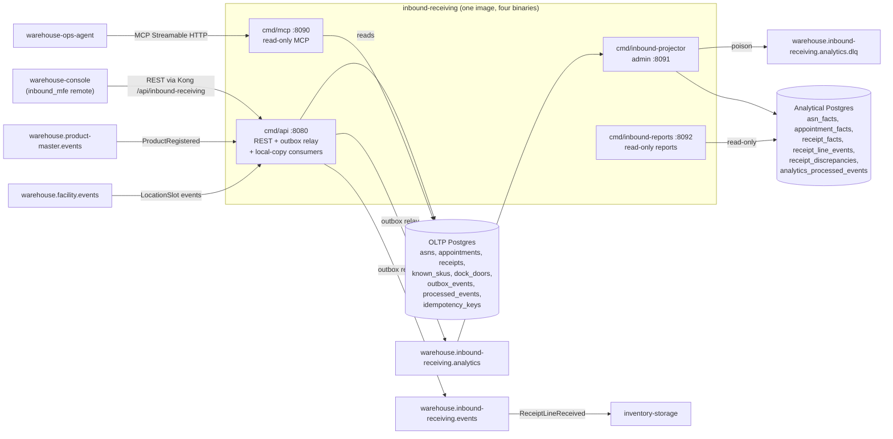

# Runtime and integration mechanics

This is the architecture page of the context: the hexagonal layout, every
binary with its role and port, the data stores and how events flow in and out.

## Container view

Source: `cmd/api/main.go`, `cmd/mcp/main.go`, `cmd/inbound-projector/main.go`,
`cmd/inbound-reports/main.go`, `internal/adapters/outbound/kafka/analytics_encoder.go`,
`internal/adapters/inbound/kafka/*.go`, `internal/adapters/outbound/postgres/migrations/0001_inbound_receiving.up.sql`,
`analytics/migrations/0001_receiving_performance.up.sql`.

## Data stores

| Store | Used by | Schema |
|---|---|---|
| OLTP Postgres (`DATABASE_URL`, required) | `cmd/api` read/write, `cmd/mcp` read | `internal/adapters/outbound/postgres/migrations` (embedded, applied at boot by api and mcp) |
| Analytical Postgres (`ANALYTICS_DATABASE_URL`, required) | `cmd/inbound-projector` (only writer), `cmd/inbound-reports` (read-only pool) | `analytics/migrations` (embedded, applied at boot by the projector) |
| Kafka (one fleet broker) | `cmd/api` (relay + 2 consumers), `cmd/inbound-projector` | topics on the [Runbook](../operations/runbook.md#kafka) |

Table-by-table descriptions are on the [Runbook](../operations/runbook.md#databases-and-migrations).

## Deployables

One container image (`Dockerfile`) builds every `cmd/*` binary into `/app`
(uid 1000; the default entrypoint is `./api`). The Helm chart
`charts/inbound-receiving` renders each one as its own component.

| Binary | Role | Port | ADR |
| --- | --- | --- | --- |
| `cmd/api` | REST API, transactional-outbox relay, the two local-copy consumers | `HTTP_ADDR` (`:8080`) | 0001 to 0004 |
| `cmd/mcp` | Read-only MCP server (Streamable HTTP at `/` and `/mcp`, `GET /healthz`) over the same read use cases and database as REST; no relay, no consumer, never dials Kafka | `MCP_ADDR` (`:8090`) | [0005](/docs/adr/0005-mcp-server-adoption) |
| `cmd/inbound-projector` | Analytics writer: consumes `warehouse.inbound-receiving.analytics` into the separate analytical database; serves only `/healthz` and `/readyz` | `ADMIN_ADDR` (`:8091`) | [0006](/docs/adr/0006-analytics-read-side) |
| `cmd/inbound-reports` | Read-only reports HTTP over the analytical database: `GET /healthz`, `GET /reports/receiving-performance`, `GET /reports/freshness` | `HTTP_ADDR` (`:8092`) | [0006](/docs/adr/0006-analytics-read-side) |

The `web/` directory is a separate npm project, not part of the Go module: see
[Web remote](#web-remote-inbound_mfe) below.

## Layers

Hexagonal architecture, enforced by the fitness tests in `internal/architecture`:

| Layer | Path |
| --- | --- |
| Domain | `internal/domain/{asn,appointment,receipt,shared}` |
| Application (use cases, ports) | `internal/application/{usecases,ports,repository,outbox,idempotency}` |
| Analytics report rules (pure) | `internal/analytics/report` (range rules, day windows, freshness lag) |
| Inbound adapters | `internal/adapters/inbound/http` (REST and the reports router), `internal/adapters/inbound/mcp` (MCP tools), `internal/adapters/inbound/kafka` (the product and dock-door consumers, and the projector's analytics consumer) |
| Outbound adapters | `internal/adapters/outbound/{postgres,memory,kafka,outbox,analyticsstore,clock,idgen,telemetry}` |
| CloudEvents helper | `internal/adapters/kafka/cloudevents` |
| Composition roots | `cmd/api`, `cmd/mcp`, `cmd/inbound-projector`, `cmd/inbound-reports` |
| Boot helper | `internal/bootretry` |

The domain imports nothing internal but itself; adapters never import each
other; only the `cmd/*` composition roots wire them.

## Writing: one unit of work per command

Every write use case (`internal/application/usecases/writer.go`) runs inside one
`ports.UnitOfWork`: load the aggregate(s), apply the aggregate command, save each
guarded by the version that was loaded, encode the raised events
(`EventEncoder`) and insert them into `outbox_events`. With Postgres the unit of
work is one transaction (`postgres/unit_of_work.go`); the in-memory adapters are
test doubles only (ADR 0011). `CloseReceipt` saves the receipt,
the ASN and the appointment in a single unit of work, so their events reach the
outbox together.

## Publishing: transactional outbox

- `cmd/api` hands the use cases `FanoutEncoder`
  (`internal/adapters/outbound/kafka/analytics_encoder.go`): every domain event
  becomes **two outbox rows**, the integration row on
  `warehouse.inbound-receiving.events` first and the analytics row on
  `warehouse.inbound-receiving.analytics` second, under **one CloudEvents `id`**
  minted once at encode time and persisted with both rows. Only `dataschema`
  differs between the two (`...:events:...` versus `...:analytics:...`). The
  integration bytes come from the unchanged `Encoder` (`encoder.go`), and a relay
  retry republishes each row's persisted bytes, so the id never changes
  (ADR 0006).
- The relay (`internal/adapters/outbound/outbox/relay.go`) drains every
  `OUTBOX_RELAY_INTERVAL` (default 1 s); a full batch (100 rows) is followed
  immediately by another pass. `OutboxRepo.Drain` claims rows with
  `FOR UPDATE SKIP LOCKED`, sends them one at a time in id order, marks each
  published, and stops at the first failure (recording `attempts` and
  `last_error`). A row that has failed `OUTBOX_MAX_ATTEMPTS` times (default
  20, `0` = unlimited) is no longer claimed and is logged once at ERROR
  ([ADR 0007](/docs/adr/0007-outbox-relay-attempt-cap)). Delivery is
  at-least-once.
- `EVENT_PUBLISHER=kafka` uses `RelaySink` (kafka-go writer, `RequireAll` acks,
  10 ms batch timeout, the `Hash` balancer on the message key); the default
  `log` sink only logs each message so the outbox still drains without a broker.

## Consuming: two local-copy consumers

`cmd/api` starts a consumer only for a copy whose mode is `kafka`
(`startConsumers`). Each decodes only through `internal/adapters/kafka/cloudevents`,
dispatches on the full `type`, runs the effect and the `processed_events` claim
in one unit of work and commits the offset only after that
(`FetchMessage` then `CommitMessages`, `internal/adapters/inbound/kafka/kafka.go`).
A transient failure retries the same message with backoff (200 ms doubling to
5 s) and never commits past it; a message that is not a valid CloudEvent, a
malformed payload or an invalid value is logged at WARN and committed past.

## Analytics read side

[ADR 0006](/docs/adr/0006-analytics-read-side) adds a separate analytical
Postgres, written only by `cmd/inbound-projector` and read only by
`cmd/inbound-reports`. Neither binary opens the OLTP database.

- **Projector.** Consumes `warehouse.inbound-receiving.analytics` under the
  fixed group `ANALYTICS_CONSUMER_GROUP` (default `inbound-receiving-analytics`).
  `Projection.Apply` claims the CloudEvents `id` in
  `analytics_processed_events` and folds the event into the fact tables
  (`asn_facts`, `appointment_facts`, `receipt_facts`, `receipt_line_events`,
  `receipt_discrepancies`) in one analytical transaction; the offset is
  committed only afterwards. A message that is not a CloudEvent is skipped with
  a rate-limited WARN, an unknown type is ignored, a poison message of a known
  type (or one the store rejects with SQLSTATE class 22 or 23) is dead-lettered
  at once to `warehouse.inbound-receiving.analytics.dlq`, and a transient
  failure is retried with capped backoff. The embedded migrations
  (`analytics/migrations`) and the first ping run under `internal/bootretry`;
  Kafka is dialled lazily.
- **Reports.** A read-only pool (`default_transaction_read_only=on`) behind
  `GET /reports/receiving-performance` (per UTC day over an optional RFC 3339
  `from` / `to`, default the last 30 days, at most 366 days; plus the state
  right now) and `GET /reports/freshness` (`as_of`, `lag_seconds`, both `null`
  until the first event). Errors are RFC 7807 with the slugs
  `invalid-report-range` (400) and `report-store-error` (500). No CORS and no
  `/readyz` on this router.
- **Chart.** Both are behind `analytics.enabled` (default `false`): components
  `analytics-projector` and `analytics-reports` (Service
  `<release>-reports:80`), with a Secret holding `ANALYTICS_DATABASE_URL` and
  `ANALYTICS_READER_DATABASE_URL` (the reports Deployment receives the reader
  DSN as its `ANALYTICS_DATABASE_URL`).

## Web remote (`inbound_mfe`)

`web/` is the Module Federation remote `inbound_mfe` (Vite + React). It exposes
one module, `./App` (default export, no props), which the `warehouse-console`
shell lazy-loads as `inbound_mfe/App` and mounts under `/inbound-receiving/*`.
Its production asset base is `/mfes/inbound-receiving/` (the Nginx web-gateway
path); `npm run dev` and `preview` serve it standalone on port `5193`. At
runtime it calls `${apiOrigin}/api/inbound-receiving` (Kong) from the shell's
`window.__WAREHOUSE_CONFIG__`; in dev without that config it calls
`http://localhost:8080`. Source: `web/vite.config.ts`, `web/src/config.ts`.
CI lints, type-checks, tests and builds it in the `web` job.

## Configuration

Every environment variable of the four binaries (default, required flag,
meaning and source file) is on [Configuration](../operations/configuration.md).
The rules that shape the runtime:

- `cmd/api` refuses to boot (`loadConfig`) without `DATABASE_URL`,
  `KAFKA_BROKERS` and both consumer groups, and on `permissive`/`off` modes or
  `EVENT_PUBLISHER=log`; the relay and both consumers always run, and the
  process exits non-zero if one of them dies (ADR 0011).
- `GET /readyz` checks Postgres and Kafka (a topic-less metadata request); the
  first start under a new consumer group replays the topic from the first
  offset and readiness does not wait for the replay, so writes can answer
  `422 unknown-sku` / `unknown-dock-door` until the copy has caught up.
- `cmd/inbound-projector` and `cmd/inbound-reports` require
  `ANALYTICS_DATABASE_URL`; the projector also requires `KAFKA_BROKERS`.

## Boot and shutdown

`cmd/api`: migrations (golang-migrate, embedded in `postgres/migrations`) and
the first Postgres ping retry with backoff (`internal/bootretry`: 5 attempts,
1 + 2 + 4 + 8 = 15 s of sleeps); on exhaustion the process refuses to boot. Shutdown order: `/readyz` flips to 503,
the drain delay elapses, HTTP drains, the consumers (outbox writers) stop, the
relay stops last so nothing committed is stranded, then the pool closes. With
Postgres, the housekeeping sweeper ([ADR 0010](/docs/adr/0010-housekeeping-sweeper))
runs alongside and stops with the consumers.

`cmd/inbound-projector`: flips `/readyz` to 503, drains the admin server, lets
the in-flight message finish (commit or dead-letter), stops the
`analytics_processed_events` sweeper, then closes the pool.

## Observability

OpenTelemetry traces and metrics (`internal/adapters/outbound/telemetry`,
OTLP/gRPC) and `otelchi` spans labelled by route pattern with request-duration
metrics on the `cmd/api`, `cmd/mcp` and `cmd/inbound-reports` routers (service
names `inbound-receiving`, `inbound-receiving-mcp`, `inbound-receiving-reports`).
Only `cmd/api` serves a Prometheus handler on `GET /metrics`. `GET /healthz` is
liveness on every binary; `GET /readyz` (readiness, 503 while draining) exists
on `cmd/api` and `cmd/inbound-projector` only.

Instruments, span names, log fields and suggested alerts:
[Observability](../operations/observability.md). Deployment, probes, topics
and routine procedures: [Runbook](../operations/runbook.md).
